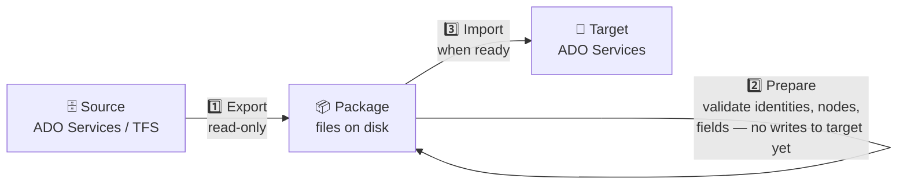
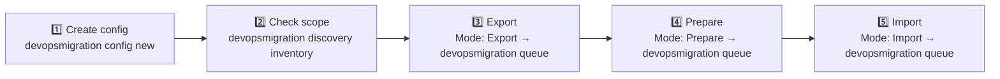

# Azure DevOps Migration Platform

> ⚠️ **Pre-release — not production-ready.** Under active development. APIs, configuration schemas, and package formats may change without notice. [Open an issue](https://github.com/nkdAgility/azure-devops-migration-platform/issues) to share feedback.

[](LICENSE)
[](https://github.com/nkdAgility/azure-devops-migration-platform/actions)

Migrate Azure DevOps and TFS data through a portable, auditable file package — not directly between live systems. Export once, prepare and validate offline, import when you're ready. Works across air-gapped networks, across organisations, and across versions.

Created and maintained by [Martin Hinshelwood](http://nkdagility.com) at Naked Agility Limited.

---

## The problem with live migration

Live migration tools connect directly from source to target. If the network drops, you start over. There's no audit trail. You can't review what will be imported before it lands. Air-gapped or on-premises environments aren't supported at all.

This platform takes a different approach:



The package is a versioned, portable snapshot on disk.Zip it, move it, review it, resume it. Export and import don't need to run on the same machine or at the same time.

---

## What you can migrate

> **Status key:**
> ✅ Complete
> 🚧 Soon
> 🔜 In Progress
> 📋 Later
> ❌ Never

### Current development status

| Scenario | Status | Notes |
|----------|:------:|-------|
| **Simulated → Simulated** | ✅ | Full Migrate pipeline (Inventory → Export → Prepare → Import) runs offline. Used for CI and integration testing. |
| **ADO → ADO Export** | ✅ | Production-ready. Work items, revisions, comments, attachments, embedded images, links, identities, nodes, teams. |
| **ADO → ADO Import** | 🔜 | Real implementation exists — work item creation, node creation, link/attachment/comment import, identity resolution. Integration validation and error-recovery hardening in progress. Not recommended for production yet. |
| **TFS → ADO Export** | ✅ | Works via the TfsMigrationAgent (.NET 4.8.1, Windows only). Work items, revisions, nodes. On net481 the export currently skips comments, include/exclude filters, WIQL selection and embedded images. |
| **TFS → ADO Import** | 📋 | TFS export produces a standard package; ADO import target exists. Must be run as **two configs** today (Export with a TFS `Source` and no `Target`, then Import with the ADO `Target`) — a single config with both is not picked up by either agent. TFS-specific identity and field mapping configs are not yet validated. |

### Migration Modules

Stages run left-to-right: **Capture** → **Export** → **Prepare** → **Import** → **Validate**

| Connector | Module | Capture | Export | Prepare | Import | Validate |
|-----------|--------|:-------:|:------:|:-------:|:------:|:--------:|
| **Simulated** | Work Items | ✅ | ✅ | ✅ | ✅ | 📋 |
| | Identities | ✅ | ✅ | ✅ | ✅ | 📋 |
| | Area & Iteration Nodes | ✅ | ✅ | ✅ | ✅ | 📋 |
| | Teams | ✅ | ✅ | ✅ | ✅ | 📋 |
| **Azure DevOps Services** | Work Items | ✅ | ✅ | 🔜 | 🔜 | 📋 |
| | Identities | ✅ | ✅ | 🔜 | 🔜 | 📋 |
| | Area & Iteration Nodes | ✅ | ✅ | 🔜 | 🔜 | 📋 |
| | Teams | ✅ | ✅ | 🔜 | 🔜 | 📋 |
| | Test Plans | 📋 | 📋 | 📋 | 📋 | 📋 |
| | Shared Queries | 📋 | 📋 | 📋 | 📋 | 📋 |
| | Git Repositories | ✅ | 🔜 | 🔜 | 🔜 | 📋 |
| | Pipelines | 🔜 | 🔜 | 🔜 | 🔜 | 📋 |
| | Permissions | 🔜 | 🔜 | 🔜 | 🔜 | 📋 |
| **Team Foundation Server** | Work Items | ✅ | ✅ | 📋 | 📋 | 📋 |
| | Identities | ✅ | ✅ | 📋 | 📋 | 📋 |
| | Area & Iteration Nodes | ✅ | ✅ | 📋 | 📋 | 📋 |
| | Teams | ✅ | ✅ | 📋 | 📋 | 📋 |
| | Test Plans | 📋 | 📋 | 📋 | 📋 | 📋 |
| | Shared Queries | 📋 | 📋 | 📋 | 📋 | 📋 |
| | Git Repositories | 📋 | 📋 | 📋 | 📋 | 📋 |
| | TFVC Repositories* | ❌ | ❌ | ❌ | ❌ | ❌ |
| | Pipelines | 🔜 | 🔜 | 📋 | 📋 | 📋 |
| | Permissions | 🔜 | 🔜 | 📋 | 📋 | 📋 |

> \* We may integrate GitTfs for TFVC repository migration in the future.

### Analisers

**Analysers** run during Capture and write reports to the package for operator review. They never write to source or target.

| Analyser | Status | Purpose |
|----------|:------:|---------|
| Inventory | ✅ | Consolidates per-module counts into a unified package-level report |
| Dependencies | ✅ | Maps cross-project work item links so operators can assess scope before import |

### Tools

**Tools** are stateless transformation services that apply during Export and Import with no I/O of their own.

| Tool | Status | Purpose |
|------|:------:|---------|
| FieldTransform | ✅ | Apply declarative field-rewrite rules to each work item revision |
| NodeTranslation | ✅ | Translate area and iteration path strings against configured mappings |
| IdentityLookup | ✅ | Resolve and remap user identities across organisations |
| WorkItemTypeTranslation | 📋 | Remap work item type names between source and target (e.g., User Story → Product Backlog Item) |

---

## Compared with Azure DevOps Migration Tools

This platform is the planned successor to [azure-devops-migration-tools](https://github.com/nkdAgility/azure-devops-migration-tools). Until it reaches parity, **use this platform to export and evaluate work-item migrations, and keep using Migration Tools for production migrations**. ADO import is not yet recommended for production (see the status table above).

_Assessment as of October 2026 (`v20.0.2-preview` series)._

### Architecture

| Migration Tools | This platform |
|-----------------|---------------|
| Copies live from source to target; both must be online at once | Source → Files → Target through a versioned, auditable package |
| Re-runs rely on a `ReflectedWorkItemId` custom field; a crash can leave a partially migrated item | Checkpoints after each item and resumes from there; `--force-fresh` to restart |
| TFS processors need .NET Framework 4.7.2 | Modern .NET, plus a separate .NET 4.8.1 agent only for TFS |
| One console exe and one large JSON config | Control Plane, agents, CLI and TUI; versioned config travels inside the package |
| Identities mapped during the live run | `Identities/mapping.json` reviewed and edited offline before import |

### Feature parity

| Capability | Migration Tools | This platform |
|------------|:---------------:|:-------------:|
| Work items, revisions, comments | ✅ | ✅ export · 🔜 import |
| Links, attachments, embedded images | ✅ | ✅ export · 🔜 import |
| Area & iteration paths | ✅ | ✅ |
| Identity mapping | ✅ | ✅ |
| Field maps / transforms | ✅ | ✅ (14 transforms) |
| Teams and board settings | ✅ incl. TFS | ✅ ADO · 📋 TFS |
| Changeset and git commit link remapping | ✅ | 📋 |
| Process / work item type definitions | ✅ | 📋 readiness check only |
| Test plans, suites, configurations | ✅ | 📋 |
| Shared queries | ✅ | 📋 |
| Pipelines, task groups, variable groups, service connections | 🧪 Beta | 📋 |
| Bulk edit, overwrite, delete utilities | ✅ | 📋 |
| Git / TFVC history, wikis, dashboards | ❌ | 📋 / ❌ |

### Usability

**Better than Migration Tools:** offline review of the package and identity map, checkpoint-based resume, pause/resume/cancel, live progress (`--follow`, TUI), downloadable diagnostics, and the `config new` wizard.

**Still behind Migration Tools:**
- **Install:** there's no winget, Chocolatey, or dotnet-tool package, and the build output zip is still named `MigrationTools-*`.
- **Runtime setup:** you need to run a Control Plane and an agent, compared with a single exe.
- **Config editing:** there's no published config JSON Schema, so editors can't offer IntelliSense.
- **Docs:** there's no catalogue of transform examples comparable to the Migration Tools docs site.
- **Error messages:** many are developer-facing (spec 004 tasks T030, T040 and T041).
- **Testing:** almost all tests run against the Simulated connector; only 14 run against live systems.

### Path to parity

1. Finish work item import hardening (specs 035, 019, 020, 029, 010) and reach a stable release.
2. Add changeset/commit link remapping and TFS board settings.
3. Improve operator UX: package distribution, publish the config schema, write a Simulated quickstart, and fix the error messages.
4. Specify and build shared queries → test plans → process definitions → pipelines.

---

## Install

> No binary release yet — install from source.

**Requirements:**
- .NET 10 SDK
- PowerShell 7+
- Windows (required only for TFS source)

```powershell
git clone https://github.com/nkdAgility/azure-devops-migration-platform.git
cd azure-devops-migration-platform
./build.ps1 install
```

This builds, tests, and installs `devopsmigration` to your PATH via `%USERPROFILE%\.dotnet\tools\`.

To start the Control Plane and Migration Agent locally after install:

```powershell
./build.ps1 start
```

---

## Get started



### 1. Create a config file

```powershell
devopsmigration config new --output migration.json
```

Or start from a [scenario in this repo](scenarios/). A minimal export config:

```json
{
  "MigrationPlatform": {
    "ConfigVersion": "2.0",
    "Mode": "Export",
    "Source": {
      "Type": "AzureDevOpsServices",
      "Url": "https://dev.azure.com/myorg",
      "Project": "MyProject",
      "Authentication": {
        "Type": "AccessToken",
        "AccessToken": "$ENV:SOURCE_PAT"
      }
    },
    "Package": {
      "WorkingDirectory": "D:\\migration-output"
    },
    "Modules": {
      "WorkItems": { "Enabled": true }
    }
  }
}
```

Set your token as an environment variable — never put it in the config file:

```powershell
$env:SOURCE_PAT = "your-pat-here"
```

### 2. Check scope (optional)

```powershell
devopsmigration discovery inventory --config migration.json
```

Counts work items and revisions per project. Read-only — nothing is written.

### 3. Export

```powershell
devopsmigration queue --config migration.json --follow
```

Runs the phase named by the config's `Mode` field (`Export` above) and writes to the package directory. `--follow` streams live progress to the terminal. There is no `--mode` flag — each later step changes `Mode` in the config. Alternatively set `"Mode": "Migrate"`: the CLI then submits Export, Prepare and Import as separate jobs in sequence. **It does not run Validate.**

### 4. Review and prepare

Add a `Target` block (same shape as `Source`, using `$ENV:TARGET_PAT`) to the config, set `"Mode": "Prepare"`, then run:

```powershell
devopsmigration queue --config migration.json --follow
```

Validates identities, nodes, and fields against the target. Produces mapping reports in the package directory. Review and fix any blocking issues before importing.

### 5. Import

Set `"Mode": "Import"` in the config, then run:

```powershell
devopsmigration queue --config migration.json --follow
```

> **TFS sources:** run Export with a TFS `Source` and **no** `Target`, then use a separate config (ADO `Target`, same `Package.WorkingDirectory`) for Prepare and Import. A single config with a TFS source and an ADO target is not picked up by either agent today.

### Resuming after failure

Every run checkpoints automatically. If it fails or is interrupted, re-run the same command — it picks up where it left off. Use `--force-fresh` to discard checkpoints and restart a module.

---

## Key CLI commands

| Command | Purpose |
|---------|---------|
| `queue` | Submit a job (Export, Prepare, Import, or Migrate). |
| `discovery inventory` | Count work items and revisions (read-only). |
| `discovery dependencies` | Analyse cross-project work item links. |
| `manage list` | List all jobs with status. |
| `manage status --job <id>` | Detailed status for a specific job. |
| `manage pause / resume / cancel` | Job lifecycle control. |
| `config new` | Wizard to create a config file. |
| `tui` | Open the interactive Terminal UI. |

Full reference: [docs/cli-guide.md](docs/cli-guide.md)

---

## Documentation

Full documentation lives in [`docs/`](docs/README.md):

- **Operators** → start with [Getting Started](docs/getting-started.md) and the [Operator Guide](docs/operator-guide.md)
- **Advanced operators** → [Control Plane](docs/control-plane.md), [Agent Hosting](docs/agent-hosting.md), [Observability](docs/observability.md), [Security & Data Sovereignty](docs/security-and-data-sovereignty.md)
- **Contributors** → [Contributor Guide](docs/contributor-guide.md) and [Development Setup](docs/development-setup.md)
- **Reference** → [Configuration](docs/configuration-reference.md), [Package Format](docs/package-format-reference.md), [Architecture](docs/architecture.md)

---

## Getting help

- [Troubleshooting guide](docs/troubleshooting-guide.md) for common failures
- [Open an issue](https://github.com/nkdAgility/azure-devops-migration-platform/issues) for bugs or feature requests
- [SECURITY.md](SECURITY.md) for vulnerability reporting — do not include customer data or migration packages in issues

---

## Contributing

Contributions are welcome. Please read [CONTRIBUTING.md](CONTRIBUTING.md) and [docs/contributor-guide.md](docs/contributor-guide.md) before opening a pull request.

- Open an issue before starting substantial work
- All pull requests must pass the CLA check before merge
- Follow existing architecture and module boundaries
- Include tests for behavioural changes
- Never include secrets, customer data, or migration packages in PRs

---

## Licence

The platform core is licensed under **AGPL-3.0-only**. Optional add-in assemblies may be provided by Naked Agility Limited under separate licence terms.

Copyright (c) Naked Agility Limited. See [LICENSE](LICENSE) and [NOTICE](NOTICE).
